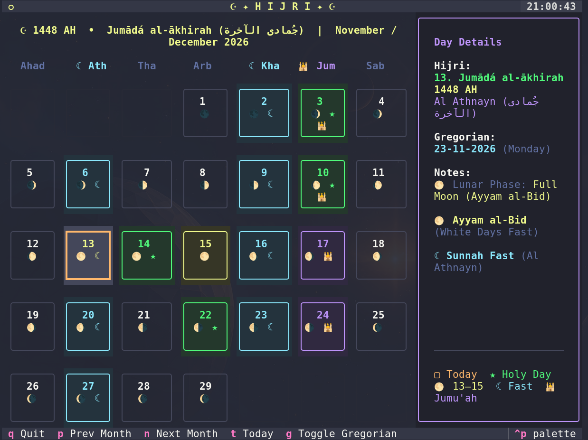
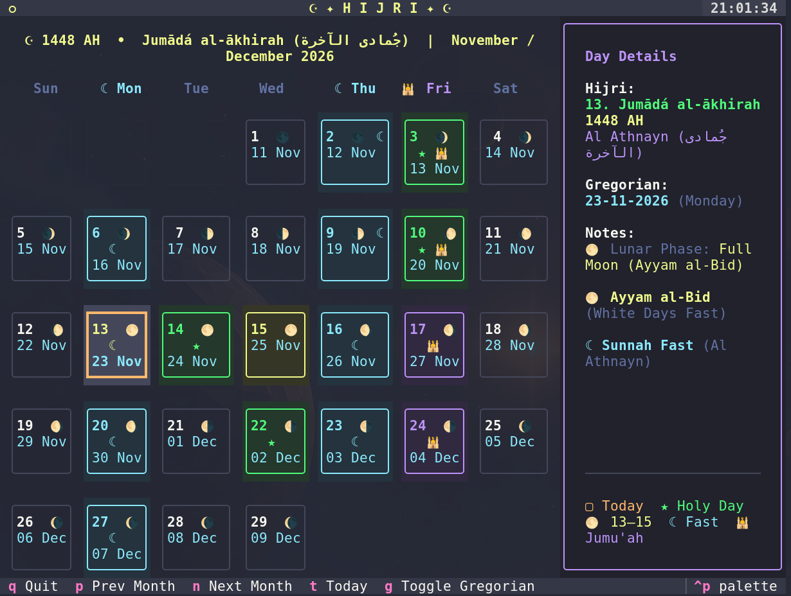

# ☪ hijri-tui

**Terminal UI for the Islamic Hijri calendar with lunar phases, Sunnah fasting days, and holy days — styled in the Dracula dark theme.**

Powered by [Textual](https://textualize.io) and the [AlAdhan Islamic Calendar API](https://aladhan.com).

---




---

## ✨ Features

- **Native Hijri Calendar Grid:** Months start on the 1st of the Hijri month and follow the Islamic week (`Al-Ahad` to `Al-Sabt`).
- **Daily Lunar Phases:** Displays the corresponding moon phase (`🌑` to `🌘`) for every day of the lunar cycle.
- **Color-Coded Highlights (Dracula Theme):**
  - 🟧 **Today:** Highlighted with a double orange border (`#FFB86C`).
  - 🟩 **Official Holy Days:** Highlighted in green (`#50FA7B`) with highest priority.
  - 🟨 **Ayyam al-Bid (13th, 14th & 15th):** Highlighted in soft yellow (`#F1FA8C`).
  - 🟦 **Sunnah Fasting Days (Al-Athnayn & Al-Khamees):** Highlighted in cyan (`#8BE9FD`).
  - 🟪 **Jumu'ah (Friday):** Highlighted in purple (`#BD93F9`).
- **Live Day Details Sidebar:** Shows Hijri date (English & Arabic), Gregorian date, lunar phase name, and fasting/holiday notes while navigating.
- **Gregorian Overlay Toggle:** Press `g` anytime to toggle Gregorian dates and weekday labels on the calendar tiles.

---

## 📦 Installation

### From Source (Editable / Local)

```bash
pipx install git+https://github.com/postsonde/hijri-tui.git
```

### Run

```bash
hijri
```

---

## ⌨️ Keybindings

| Key | Action |
| :--- | :--- |
| `←` `→` `↑` `↓` | Navigate across days in the calendar grid |
| `n` | Next Hijri month |
| `p` | Previous Hijri month |
| `t` | Jump back to today's Hijri date |
| `g` | Toggle Gregorian dates & weekday names |
| `Ctrl+P` | Open Textual command palette |
| `q` | Quit application |

---

## 🙏 Credits

- Calendar & Hijri conversion data provided by the [AlAdhan API](https://aladhan.com).
- Color palette based on the [Dracula Theme](https://draculatheme.com).

---

## 📄 License

This project is licensed under the **GNU General Public License v3.0 (GPLv3)** — see the [LICENSE](LICENSE) file for details.
